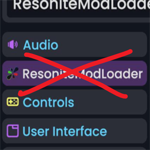

# HideRMLMenu

A [Resonite](https://resonite.com/) mod that hides the ResoniteModLoader (RML) settings menu.

## Installation

1. Install [BepisLoader](https://thunderstore.io/c/resonite/p/ResoniteModding/BepisLoader/).
2. Install via a Thunderstore mod manager or download from [Releases](https://github.com/MarkN2000/HideRMLMenu/releases).

## License

[MIT](https://github.com/MarkN2000/HideRMLMenu/blob/main/LICENSE) © 2026 markn2000

[markn`s homepage](https://markn2000.com/posts/2025-09-08-resonite-mod-list/)
